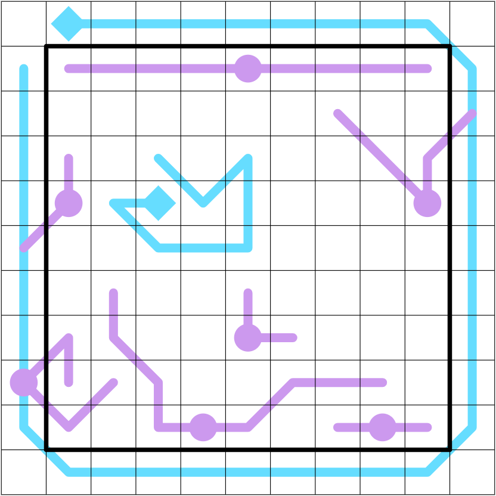

# Every Clue Is an Address



## Rules

- **Latin square:** place the digits 1–9 once each in every row and column.
- **Index lines (turquoise):** the value in the Nth cell along an index line, counting from the diamond, is the position along the line where the value N appears.
- **Zipper lines (lavender):** pairs of cells the same distance from the centre of a zipper have the same sum. When the centre is a cell, that sum is the centre's value. Different lines can have different sums.
- **Full Rank:** each outer clue is the rank of the 9-digit number read from that side, from 1 (lowest) to 36 (highest). All 36 numbers are different.

## Answer

```
4 6 2 8 9 1 7 3 5
8 5 6 7 3 4 1 9 2
2 4 3 5 7 9 6 1 8
6 8 1 2 4 7 3 5 9
1 7 9 6 5 3 2 8 4
9 3 7 4 6 8 5 2 1
7 1 5 3 8 2 9 4 6
3 9 4 1 2 5 8 6 7
5 2 8 9 1 6 4 7 3
```

## How the solve path was found

The key idea: the turquoise line around the outside runs through all 36 clue cells, so the clues pair up (if position i shows j, position j shows i). Numbers that start with the digit d always take ranks 4d−3 to 4d.

- `solver/model.py` is a CP-SAT model of the whole puzzle. It finds the solution and confirms it is unique.
- `solver/ablate.py` removes one clue family at a time to see which clues are needed. Only the inner index line is essential for uniqueness.
- `solver/verify1.py` checks that each deduction in the first half of the video follows from only the clues that step cites.

## Rendering the video

The video is an HTML/SVG scene with a deterministic `renderAt(t)` function. Playwright captures each frame and ffmpeg encodes them. The soundtrack is synthesised with NumPy.

```bash
cd video
npm install
node preview.js out 30 120          # render a few test frames
node capture.js 0 1 build           # render every frame (split across N workers with: node capture.js i N build)
python3 audio.py build/timeline.json build/soundtrack.wav
./finalize.sh
```

The script lives in `video/steps.js`: chapters, steps, on-screen text and board actions.
