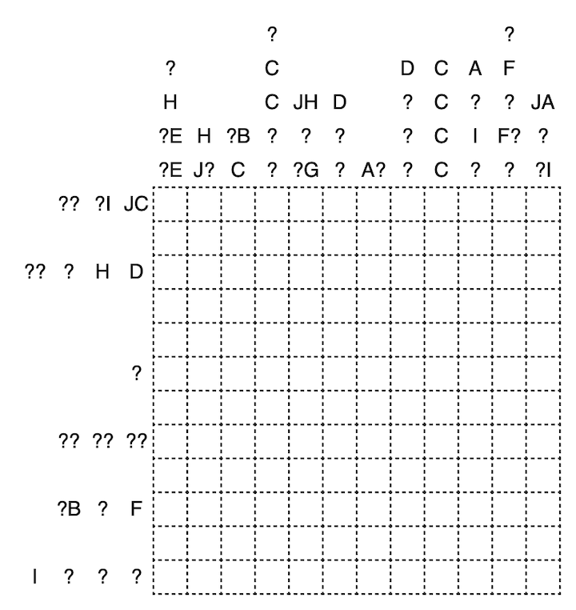

# Cipher Loop



## Rules

- Draw a loop along cell edges that does not touch or cross itself. Place the numbers 1–9 in every cell inside the loop, with no repeats in a row or column. Cells outside the loop stay empty.
- Every 1, 2 and 3 equals the number of its four sides that are part of the loop.
- Clues outside the grid give the sums of the connected groups of numbers in that row or column, in order. Empty cells separate the groups.
- The letters A–J stand for the digits 0–9, each a different digit. A `?` can be any digit, and no clue has a leading zero.

## Answer

```
8 5 . 9 6 . 2 1 7 4 3 .
. 2 . . 1 9 4 8 . . . .
5 1 6 . 7 . 8 . . 3 2 4
3 . 5 1 4 . 6 . . . . 2
. . 9 6 . . 7 . 2 5 4 8
. . . . . . 1 2 5 . . .
4 . 2 7 8 6 9 . . . 5 .
9 8 1 . . . 5 4 6 . 7 3
. 7 4 8 2 . . 5 1 6 9 .
6 4 . . 5 . . . . 2 . .
7 . . 2 9 5 . 3 4 1 8 6
. . . 5 . 4 . . 3 . . 9
```

A=4 B=0 C=7 D=9 E=3 F=2 G=6 H=8 I=5 J=1

## How the solve path was found

- `solver/model2.py` is a CP-SAT model of the full puzzle (loop connectivity, no holes, no touching corners, the 1/2/3 rule, group sums, cipher). It confirms the solution is unique.
- `solver/engine2.py` is a deduction engine that only uses explainable reasoning: fitting one row or column at a time (optionally with its neighbours' wall counts), the 1/2/3 rule, the no-touch rule, region connectivity, Latin-square eliminations and the cipher.
- `solver/trial3.py` runs that engine. When single-line reasoning stalls, it tries short what-if hypotheses in parallel and keeps the simplest one that leads to a contradiction. Its 94-step path is saved in `solver/steps3.pkl`. The engine only tests hypotheses that are false in the known solution, so time isn't spent on ones that can't break. Every deduction is still proved by contradiction, not read from the answer.

The video explains the rules, the cipher and the opening in detail (`video/script_head.js`, `video/script_mid.js`, hand-written and checked by independent reviewers). The rest is a time-lapse of the engine's deductions, generated by `video/gen_script.py`.

## Rendering the video

The scene uses a WebGL nebula background (`bg.js`), a Three.js intro, an SVG board with a CSS 3D camera, and a canvas particle layer (`spectacle.js`). Frames are captured with Playwright using SwiftShader.

```bash
cd video
npm install
python3 gen_script.py 0 5 && python3 assemble.py    # rebuild the script from solver/steps3.pkl
node preview.js out 30 300 700                      # test frames
node capture.js 0 1 build                           # all frames (or split: node capture.js i N build)
python3 audio2.py build/timeline.json build/soundtrack.wav
./finalize.sh
```
