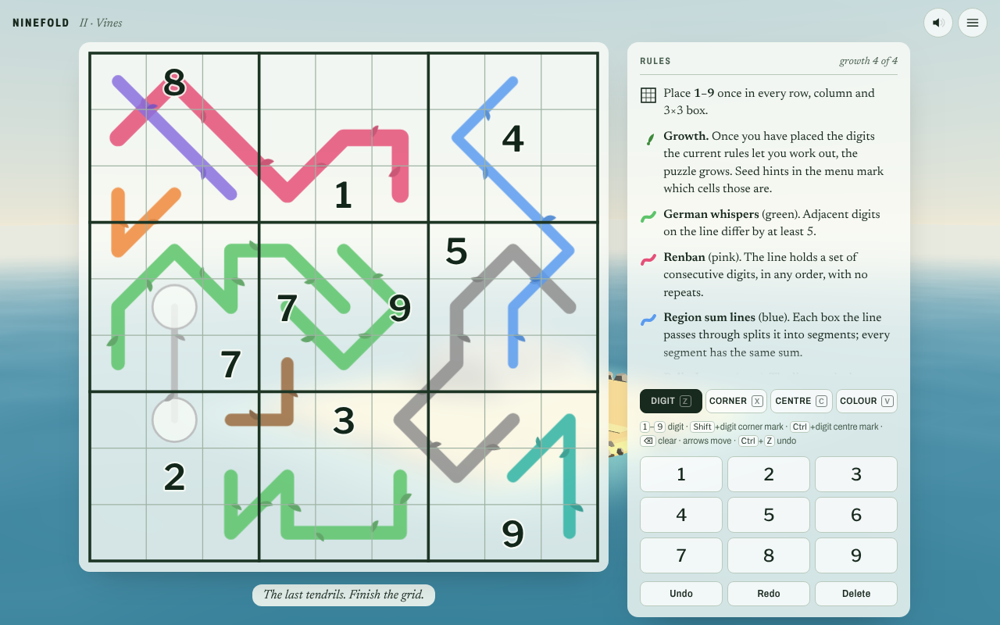

# Ninefold



A sudoku that grows. It opens as a small 4×4 printed like a newspaper puzzle. Solving it unfolds the grid into a 9×9, and from there the puzzle keeps adding rules, changing its look and growing in scale over five acts. It ends by leaving sudoku behind for line-drawing panels on a 3D island built from the grids you solved.

- **Play:** open [`ninefold.html`](ninefold.html) in a browser. It is one self-contained page; it loads three.js r128 and fonts from public CDNs.
- **Walkthrough:** [`Ninefold-Walkthrough.pdf`](Ninefold-Walkthrough.pdf) shows how a person can deduce every stage, with diagrams drawn by the game's own renderer.

## The acts

| Act | What it adds |
|---|---|
| I · Paper | 4×4 prelude → classic 9×9 → killer cages → a thermometer and an arrow → X and a white kropki dot |
| II · Vines | Line clues in four growths: German and Dutch whispers, renban, palindrome, region sum, between, entropic, modular and zipper lines |
| III · Fog | Fog of war over the grid. Correct digits clear it and reveal sandwich, X-sum, skyscraper, little-killer and quadruple clues |
| IV · Survey | Invented terrain rules: every digit is a height. Rivers take the steepest way down, lakes sit below their shores, contours split uphill from downhill, summits stand above their neighbours, and in the evening the sun casts shadows. The 3D land rises as you solve |
| V · Island | Seven line-drawing panels with their own symbols: sums per region, stones, petals (side counts), diamonds and gaps |

Each act grows in stages: once you have placed the digits the current rules let you work out, new rules appear. Those cells are the stage's *seeds*. They are hidden by default; **Menu → Seed hints** marks them with sprouts.

## How the puzzles were checked

- `tools/nf.py` holds two solvers: a human-style propagation solver (singles, locked candidates, subsets, one-clue-at-a-time reasoning) and a CP-SAT model (OR-Tools) for uniqueness.
- Every 9×9 grid and every panel has exactly one solution.
- For every stage, the human-style solver confirms its seed cells can be deduced from the rules visible at that point, with no guessing.
- `tools/fogsim.py` plays Act III's fog rules round by round and confirms you can never be stranded by the clues you can see (7 reveal rounds).
- `tools/paths.py` enumerates every lattice path through each Act V panel and checks that exactly one satisfies its symbols.

Design files:
- `tools/act1.py`, `act2.py`, `act4.py` (with `act4.json`, `a4b_32.pkl`): the stage specs of Acts I, II and IV.
- `tools/a3_final.pkl`: Act III (solution, givens, clues).
- `tools/act5.json`: the Act V panels.
- `tools/export.py` writes them all to `app/src/data.js`.

## Building

```bash
cd tools && python3 export.py      # puzzle data -> app/src/data.js (needs ortools)
cd ../app && python3 build.py      # app/src/* -> app/dist/ninefold.html
```

The walkthrough figures are rendered from the game's own code:

```bash
cd tools && python3 wt_figs.py && python3 walkthrough.py   # -> walkthrough/walkthrough.html
cd ../test && node pdf.js                                   # -> walkthrough/Ninefold-Walkthrough.pdf
```

## Tests

Playwright + Chromium. `test/harness_env.js` serves `app/dist/ninefold.html` the way the artifact host wraps it and routes three.js to `app/vendor/`. Set `NF_APP=app`.

- `t8.js`: full playthrough from the 4×4 to the credits.
- `t12.js`: saves, the fog overlay, pencil-mark slots and the rule highlight.
- `t14.js`: Act V saves and the landscape layout.
- `t16.js`: touch on phones.
- `t17.js`, `t19.js`: progression edge cases (reloads mid-growth, transitions, replays, the ending).
- `t20.js`: blocked storage, rotation and fog cost.
- `t21.js`: seed hints.
- `iframe2n.js`: keyboard input inside a cross-origin iframe.

```bash
cd test && NF_APP=app node t8.js
```
